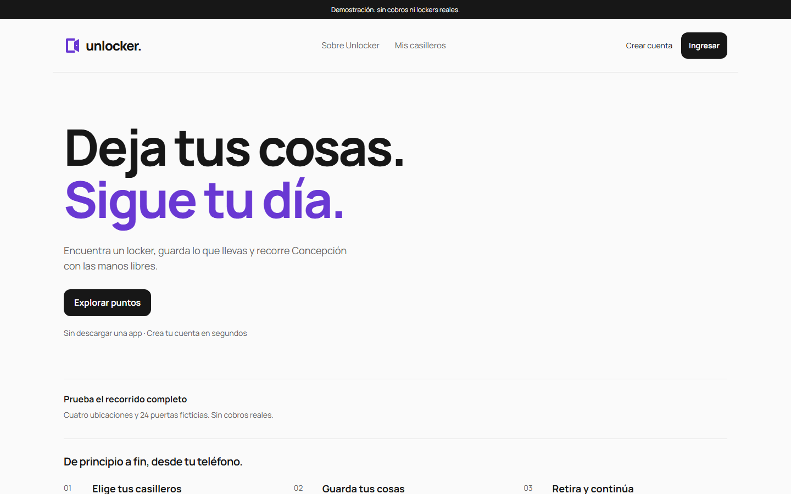
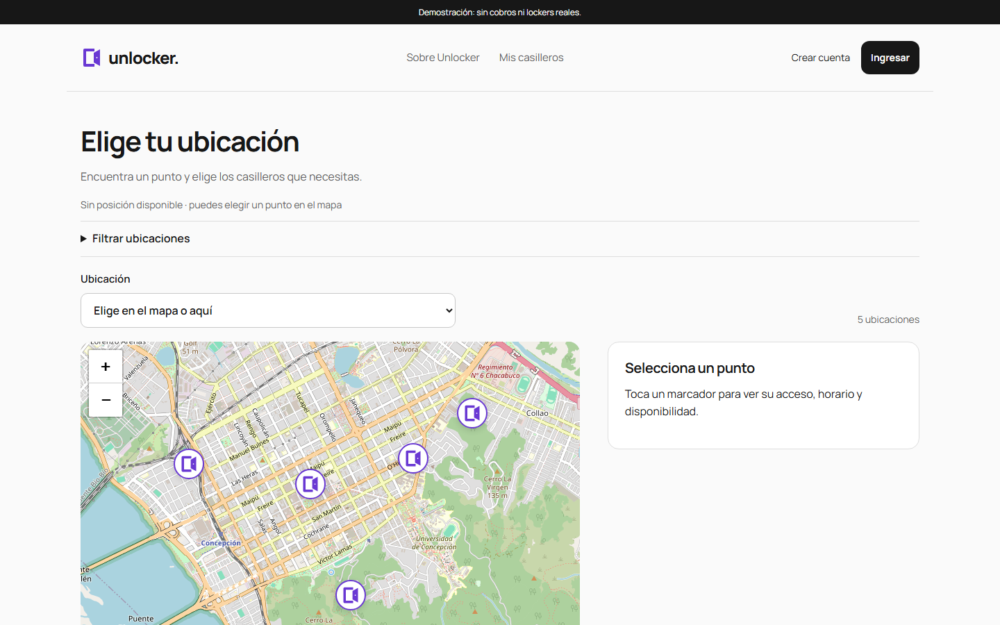

# Unlocker

Plataforma web *mobile first* para encontrar puntos de lockers en un mapa, elegir casilleros y gestionar el arriendo de principio a fin: depósito, uso, retiro y pago.

**[Ver demo en vivo →](https://unlocker-beta.vercel.app)**

> MVP de demostración: las ubicaciones son ficticias, y el hardware y los pagos están simulados. El código fuente es privado; este repositorio documenta el proyecto.

## Funcionalidades

- **Explorar:** mapa con ubicaciones, filtros y cercanía según la posición del usuario (solo si la autoriza, sin guardar historial GPS).
- **Selección física:** el usuario elige puertas exactas sobre la distribución real de cada equipo; la asignación es atómica (todas o ninguna).
- **Arriendo completo:** depósito, uso, retiro, cierre y cálculo tarifario por tiempo real, con pago simulado.
- **Acceso compartido:** invitar a otra cuenta verificada para abrir o retirar, con vigencia y revocación.
- **Cuentas:** uso como invitado o con cuenta (correo/contraseña o Google), historial propio y vinculación de invitado a cuenta.
- **Administración y operación:** catálogo de ubicaciones, equipos y puertas; incidencias; estadísticas por punto; roles verificados en servidor.
- **PWA:** instalable en el celular, con QR por punto y equipo.

## Stack

| Capa | Tecnologías |
|---|---|
| Frontend | Next.js (App Router), React, TypeScript, Leaflet, Radix, Motion |
| Backend | API de Next.js, Firebase Admin SDK |
| Datos y auth | Firestore, Firebase Authentication, App Check |
| Infraestructura | Vercel |
| Calidad | 60+ pruebas automatizadas (Node test runner), pruebas con emuladores de Firebase, ESLint, TypeScript estricto |

## Decisiones técnicas destacadas

- **Asignación exclusiva con transacciones de Firestore:** dos usuarios no pueden arrendar la misma puerta, y las operaciones son idempotentes.
- **Control de costos de lectura:** caché de servidor para el catálogo público, consultas paginadas y frecuencia de sondeo adaptativa (más rápida solo durante un arriendo activo y pausada en pestañas ocultas). Surgió de un incidente real de cuota excedida en Firestore.
- **Seguridad:** permisos de administración verificados en servidor, correo verificado para arrendar con cuenta, límites de uso por usuario en la API y App Check.
- **Modelo de datos documentado:** modelo relacional del MVP con diagrama ER y su correspondencia con las colecciones de Firestore.

## Autor

Angelo López Quintana · [LinkedIn](https://www.linkedin.com/in/angelo-lq/)
